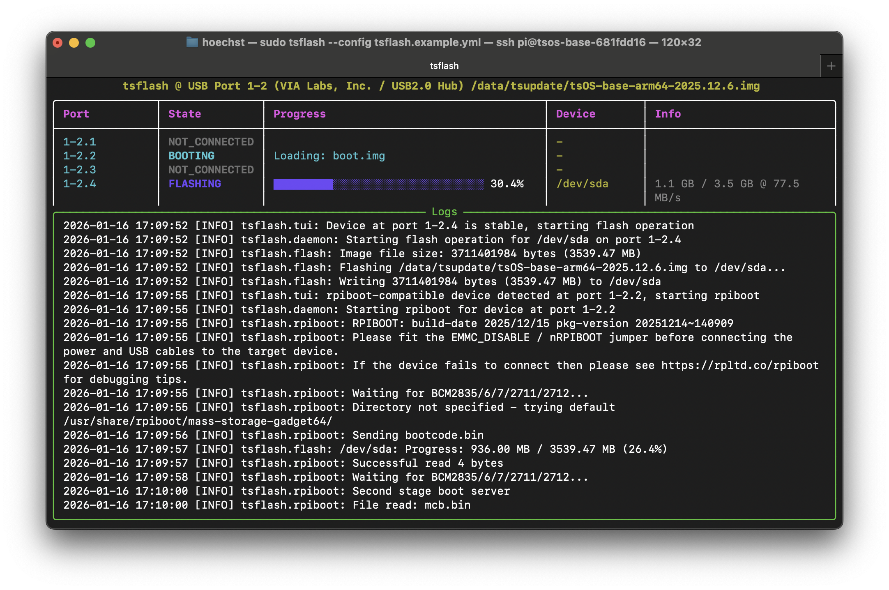

# tsflash

Flash OS images to SD cards and Raspberry Pis connected to a USB hub, many in parallel.

tsflash watches the ports of a USB hub and flashes every card or device that is plugged in. Raspberry Pi compute modules without an SD card are first booted into mass storage mode with `rpiboot`. Use the interactive TUI or run it as a headless daemon.



## Installation

Requires Linux or macOS and Python 3.11+. Booting Raspberry Pis additionally needs [`rpiboot`](https://github.com/raspberrypi/usbboot) in `PATH` (macOS: `brew install rpiboot`).

```bash
pip install .
```

## Usage

All commands that write to devices need root. `-v` (debug) and `-q` (warnings only) are global options and go before the command.

### TUI

```bash
sudo tsflash tui [IMAGE] [--port 1-2] [--block-size 4M] [--stable-delay 3]
```

Without `IMAGE`, a setup page lists the `.img` and `.iso` files in the current directory (newest first) and the USB port tree, and asks for the image and the port. Press Enter to accept the newest image and the default hub, or type a number, path or port name.

Monitors the default hub (or `--port`) and flashes each device after it has been connected for `--stable-delay` seconds. To quit, press `q` or `Ctrl+C` twice within 3 seconds; any other key cancels. Flash operations still running are aborted, and the affected devices are listed as incomplete on exit.

| State | Meaning |
|-------|---------|
| `NOT_CONNECTED` | Port is empty |
| `UNKNOWN` | Device without anything to flash, e.g. a card reader without a card ("No medium") |
| `BOOTING` | `rpiboot` is booting a Raspberry Pi into mass storage mode |
| `WAITING` | Block device found, waiting for the stable delay |
| `FLASHING` | Image is being written |
| `COMPLETED` | Done; remove the card or device to reset the port |
| `FAILED` | Stays until the card (flash failure) or the device (rpiboot failure) is removed |
| `IGNORED` | Not handled: the device holds the running system, or exposes more than one block device |

### Daemon

```bash
sudo tsflashd [--config PATH] [-v | -q]    # or: tsflash daemon [--config PATH]
```

Same behaviour as the TUI, without a user interface. Settings are read from `/boot/firmware/tsflash.yml` by default (template: [`tsflash.example.yml`](tsflash.example.yml)):

| Key | Default | Description |
|-----|---------|-------------|
| `image_path` | required | Image to flash (`.img` or `.iso`) |
| `port` | default hub | USB hub port to monitor, e.g. `1-2` |
| `block_size` | `4M` | Write block size, e.g. `1M`, `512K` |
| `stable_delay` | `3` | Seconds to wait after a device appears |
| `log_level` | `INFO` | `DEBUG`, `INFO`, `WARNING`, `ERROR` or `CRITICAL`; `-v` / `-q` override it |

`SIGTERM` or `SIGINT` stop the daemon and abort running flash operations.

### Other commands

```bash
sudo tsflash flash IMAGE DEVICE [--block-size 4M] [--non-interactive]   # flash one device
tsflash usb [--all | --port 1-2] [--json]                               # list hub ports and devices
sudo tsflash rpiboot [-p 1-2.3]                                         # boot a Pi into mass storage mode
```

The default hub is the first hub that has no other hubs below it, which skips hubs built into computers and docks. `tsflash usb` shows the port tree of the default hub, or of all ports (`--all`) or one port (`--port`). For each device it lists block devices with their size and notes how tsflash will treat it: no medium, system disk, several block devices, or Raspberry Pi in USB boot mode.

## Safety

- Disks holding `/`, `/boot` or `/boot/firmware` are never flashed, including all of their partitions.
- Ports exposing more than one block device with a medium are not handled (e.g. multi-slot card readers with several cards).
- `tsflash tui` and `tsflash daemon` refuse to start while `devmon` is running, as it would mount devices during flashing.

## macOS

- Ports are named like on Linux and in `rpiboot -p`: `<controller>-<port>.<port>…`, e.g. `0-1.4.2`. Run `tsflash usb --all` to find your hub.
- Devices are listed as `/dev/diskN` and written through the raw device `/dev/rdiskN`, which is much faster.
- macOS mounts inserted cards automatically; tsflash unmounts them (`diskutil unmountDisk`) before flashing. Dialogs about unreadable disks can be dismissed.
- The disk holding `/` and the data volume (resolved through its APFS container) is never flashed.

## USB 2.0/3.0 hubs

A USB 3.0 hub appears to the operating system as two hubs, one for USB 2.0 and one for USB 3.0 devices. tsflash merges each pair, so every physical port is listed once under its USB 2.0 name, whichever half the device uses.

- **Linux:** the halves are on different buses (e.g. `3-1` and `4-1`). The pairing assumes odd bus numbers are USB 2.0 and the next even bus is USB 3.0, which holds on Raspberry Pi 4 and 5 (see [#1](https://github.com/trackIT-Systems/tsflash/issues/1)).
- **macOS:** the halves are paired by the Container ID both report. Hubs that share a Container ID with more than one other hub (seen on some cheap hub chips) are listed separately.

## Development

```bash
pip install -e . --group test    # pip >= 25.1; or: uv run --group test pytest
pytest
```
